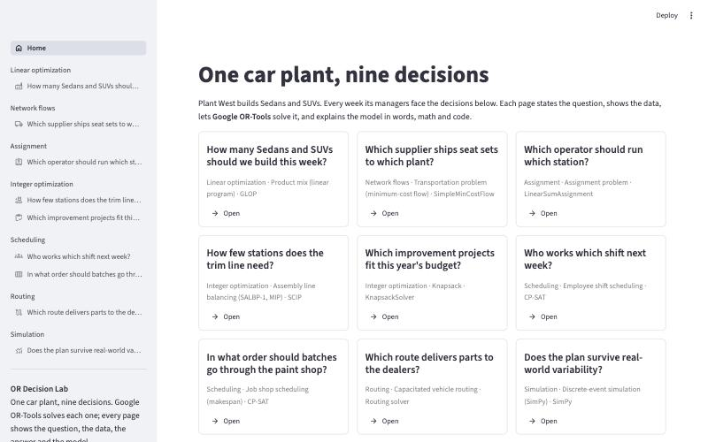
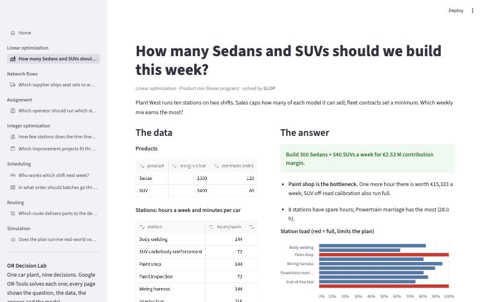

# OR Decision Lab

**One fictional car plant, nine decisions, each solved by Google OR-Tools and explained in words, math and code.**

Plant West builds Sedans and SUVs. Every week its managers face the questions below. Each page of the app states the question, shows the data (editable), lets OR-Tools solve it in milliseconds, shows the answer with one chart and two or three plain-words findings, offers "what if" sliders, and ends with *How it's modelled*: the model in words, the math, the exact Python that solved it, and which solver did it and why. The layout follows the Google OR-Tools guides: declare the solver → variables → constraints → objective → solve → read the answer.



## The nine decisions

| # | Family (solver) | The question | Model |
|---|---|---|---|
| 1 | Linear optimization (GLOP) | How many Sedans and SUVs should we build this week? | Product mix LP; dual values say what one more hour at a station is worth |
| 2 | Network flows (SimpleMinCostFlow) | Which supplier ships seat sets to which plant? | Transportation problem |
| 3 | Assignment (LinearSumAssignment) | Which operator should run which station? | Assignment problem |
| 4 | Integer optimization (SCIP) | How few stations does the trim line need? | Assembly line balancing (SALBP-1), then smoothed |
| 5 | Integer optimization (KnapsackSolver) | Which improvement projects fit this year's budget? | 0-1 knapsack; shows where greedy falls short |
| 6 | Scheduling (CP-SAT) | Who works which shift next week? | Shift scheduling: coverage, 11 h rest, shift limits, days-off requests |
| 7 | Scheduling (CP-SAT) | In what order should batches go through the paint shop? | Job shop, minimum makespan, Gantt chart |
| 8 | Routing (routing solver) | Which route delivers parts to the dealers? | Capacitated vehicle routing, routes on a map |
| 9 | Simulation (SimPy) | Does the plan survive real-world variability? | Discrete-event simulation of the line: random times, breakdowns, buffers, rework, 95 % confidence intervals |

Decision 9 tests the plan from decision 1: the paper plan says 840 cars a week, the simulated line delivers about 770, and the page names the bottleneck the LP cannot see.



## How to run
Python 3.10 or newer (3.12 recommended).
```bash
uv venv --python 3.12
uv pip install -e ".[app,dev]"
.venv/bin/streamlit run app/Home.py
.venv/bin/pytest
```
The tests solve every model on a case small enough to check by hand; the hand calculation is in each test's docstring.

## Where things are
- `src/orlab/problems/<key>.py`: one file per decision with the example data, `solve(data)`, `explain(data)` and the math in the docstring. The app shows that docstring and that source, so page, math and code cannot drift apart.
- `src/orlab/registry.py`: the catalogue (question, family, solver, why that solver).
- `src/orlab/simulate/`, `src/orlab/plant.yaml`: the SimPy line and the plant's data.
- `app/guide.py`: the one page layout; `app/pages/<key>.py` adds a chart and the what-if sliders.

All data is invented. Built by Abdallah Shaheen, Industrial Engineering student (German Jordanian University, exchange year at RPTU Kaiserslautern), as a portfolio of operations research models he can explain in an interview.
