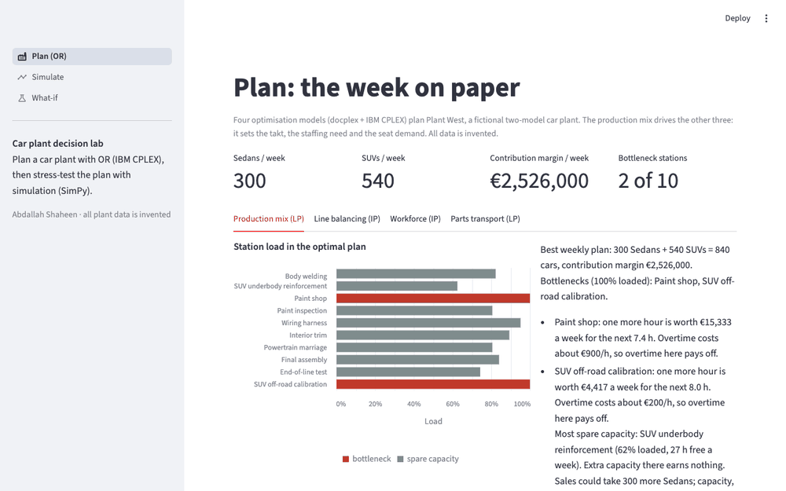

# Car plant decision lab

**Status:** done (phase 3 of 3, 25.10.2026): the OR core plans the plant with IBM CPLEX, a SimPy simulation stress-tests the plan, what-ifs compare paper with reality, and a Streamlit app shows it all. Recommendations: [docs/memo.md](docs/memo.md).

**Question:** How should a mixed-model car assembly plant (Sedan + SUV) plan its week: what to build, how to lay out the line, whom to staff on which shift, and where to buy parts from? And does that plan survive real-world variability?



## What it does
Four optimisation models plan one fictional plant (`src/plantlab/plant.yaml`, ten stations, two shifts, 07:00–23:00). Each prints its result and a plain-English summary.

| Model | Type | Answers |
|---|---|---|
| Production mix | LP | Best weekly Sedan/SUV mix; bottlenecks; what one extra hour at each station is worth (shadow prices + ranging) |
| Line balancing | IP (SALBP-1) | Fewest stations for the wiring + trim line at the plan's takt, then the smoothest balance |
| Workforce | IP | Permanent, temporary and cross-trained (floater) operators per station and shift at minimum cost |
| Parts transportation | LP | Cheapest seat-set flows from three suppliers to three plants; value of extra supplier capacity |

The weekly plan from the production mix feeds the other three (takt time, staffing need, seat demand).

Example (current data): build 300 Sedans + 540 SUVs a week (€2.53 M margin). Paint and SUV off-road calibration are the bottlenecks; one more paint hour is worth €15,333 a week for the next 7.4 h, far above the €900/h overtime cost.

## Paper vs reality (simulation)
A SimPy model builds the plan on the same line with what the LP leaves out: random station times (fitted to time studies with scipy.stats and a KS test), breakdowns, small buffers that block, and SUVs that fail the off-road test and come back for rework. Twenty replications give 95% confidence intervals; scenarios share random numbers per station, so each is compared with the base plan by a paired interval.

| Scenario | Plan (LP) | Simulated cars/week | Simulated margin vs base | Bottleneck |
|---|---|---|---|---|
| Base plan | 840 | 769 ± 11 (−8.4%) | €2.31 M (paper: €2.53 M) | Off-road calibration |
| Rework-aware plan | 847 | 788 ± 11 | +€20k ± 16k | Paint shop |
| 2nd off-road cell | 827 | 773 ± 10 | +€81k ± 28k (LP said +€35k) | Paint shop |
| Double buffers | 840 | 794 ± 11 | +€73k ± 14k, but WIP 34 → 56 cars | Off-road calibration |

The LP loads paint and the test cell to 100%. Rework makes the test cell need about 106%, and a station planned at 100% loses output to every disturbance. A car spends 3.6 h in the plant for 1.3 h of work.

## The app
`streamlit run app/streamlit_app.py` opens four pages:
- **Plan (OR):** the four CPLEX models with charts: station loads and shadow prices, the balanced line against the takt, staffing per shift, supplier flows.
- **Simulate:** the plan on the simulated line: KPIs with confidence intervals, paper vs reality, load on paper vs active and blocked time per station, the fitted distributions.
- **What-if:** the three built-in scenarios, plus your own (paint units, off-road cells, buffers, rework rate, availability). CPLEX re-plans, SimPy re-simulates, in about two seconds.
- **Ask** (optional, only with `ANTHROPIC_API_KEY`): type a what-if in plain words. Claude (Sonnet) writes the scenario through a strict tool schema, the lab runs it, and Claude explains the result using only the lab's numbers. The model never does the maths.

## How to run
Needs Python 3.10–3.14 (uses the free IBM CPLEX Community Edition, limited to 1,000 variables and constraints; the models stay below that).
```bash
uv venv --python 3.12
uv pip install -e ".[dev,app]"            # add ai for the optional assistant: ".[dev,app,ai]"
.venv/bin/streamlit run app/streamlit_app.py
.venv/bin/python -m plantlab plan         # the four CPLEX models
.venv/bin/python -m plantlab fit          # input analysis: fitted distributions + KS test
.venv/bin/python -m plantlab simulate     # KPIs with 95% CIs, bottleneck
.venv/bin/python -m plantlab loop         # paper vs reality: base plan + 3 what-ifs (~10 s)
.venv/bin/pytest                          # tests: hand-checked cases, M/M/1, flow conservation, assistant
```
For the Ask page: `export ANTHROPIC_API_KEY=...` before `streamlit run`.

## Data
All plant data is invented for this project. Station names follow a generic car assembly flow; no real plant, company or course case is used.

## Repo map
See [INDEX.md](INDEX.md). Decisions in `decisions/log.md`, one summary per work session in `sessions/`.

## Author
Abdallah Shaheen, Industrial Engineering student (German Jordanian University; exchange semester at RPTU Kaiserslautern).
